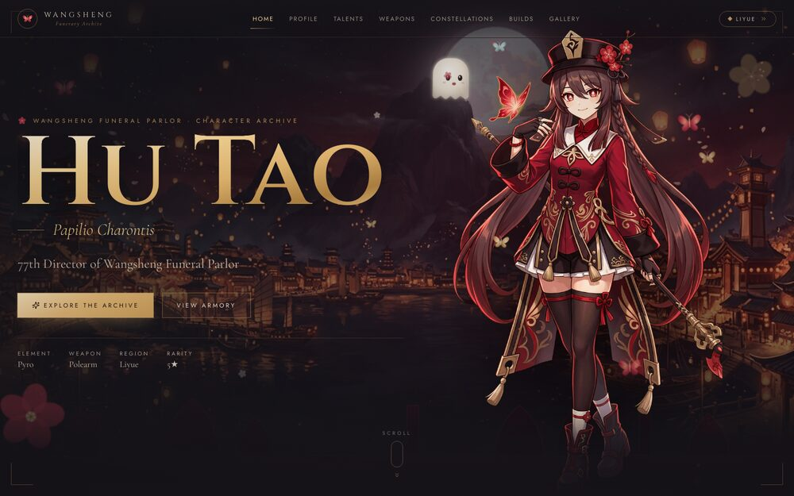
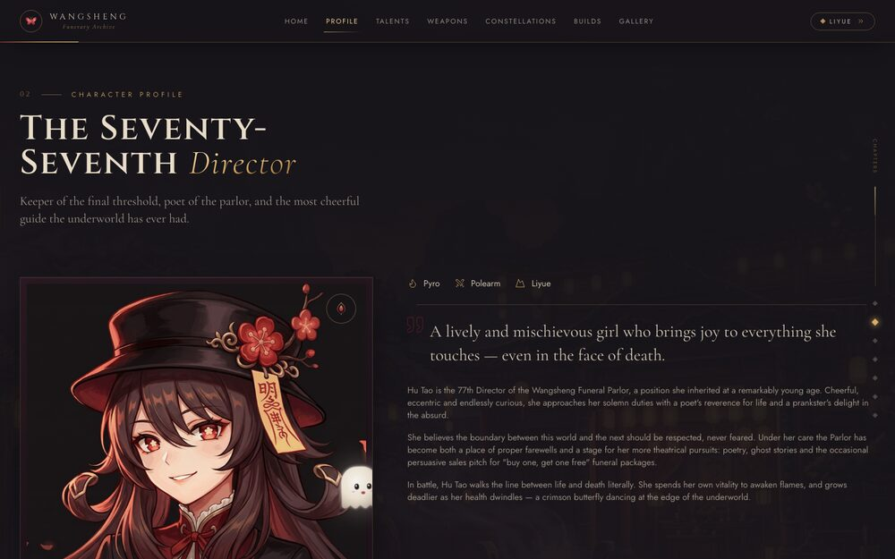
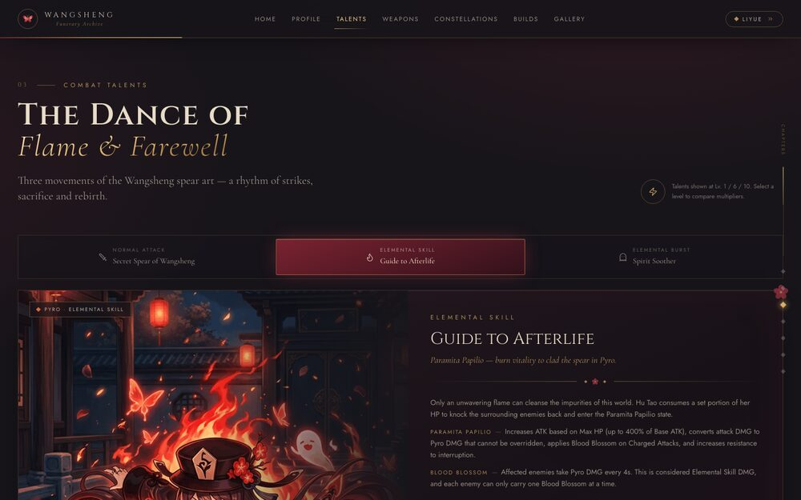
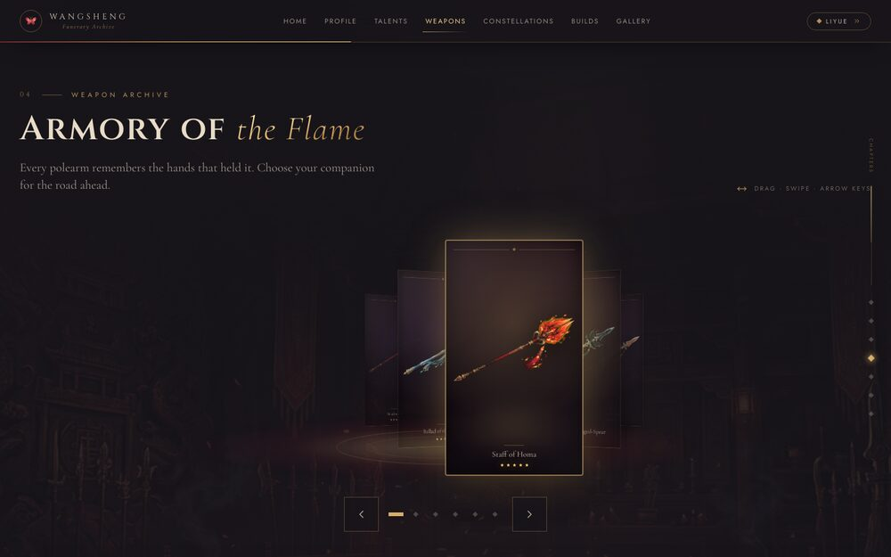
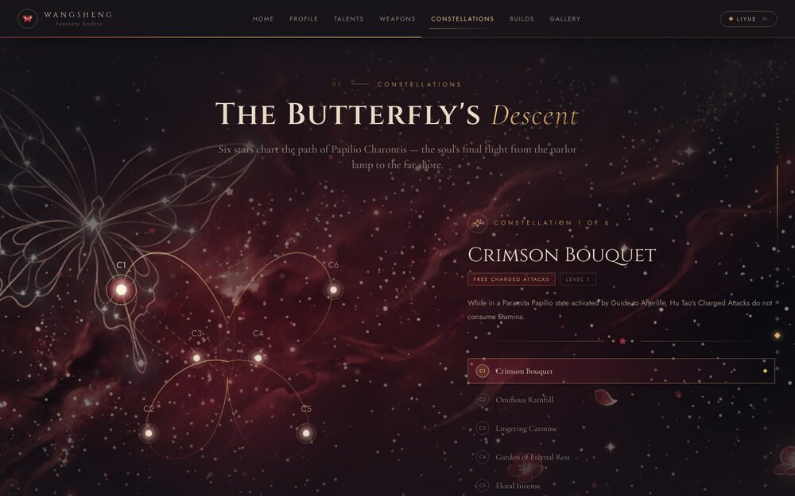
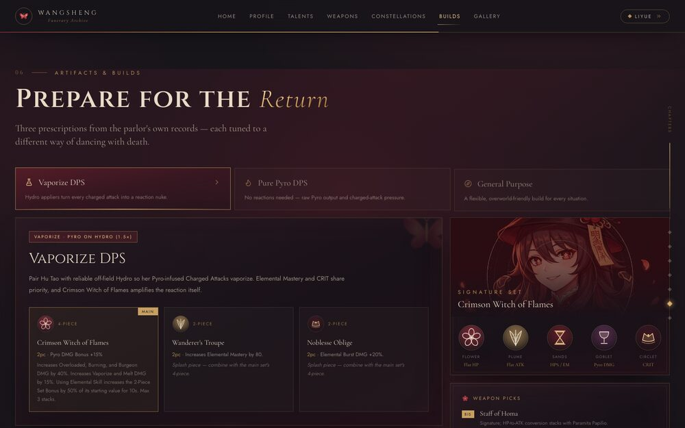
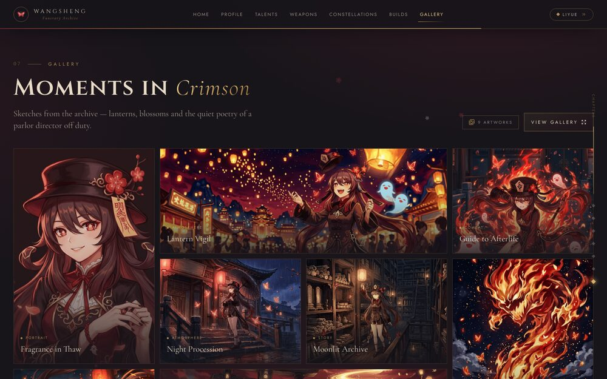
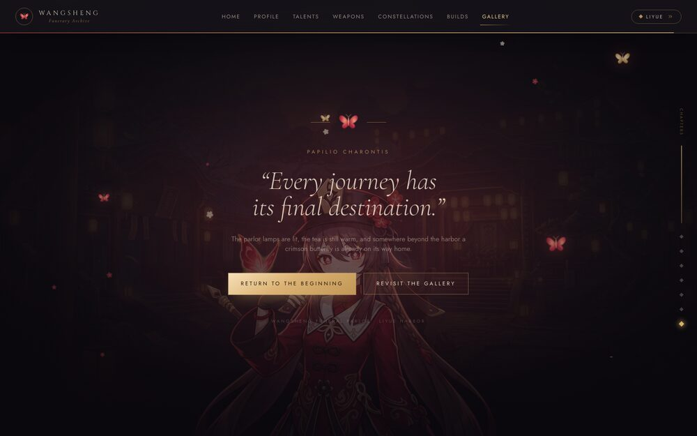
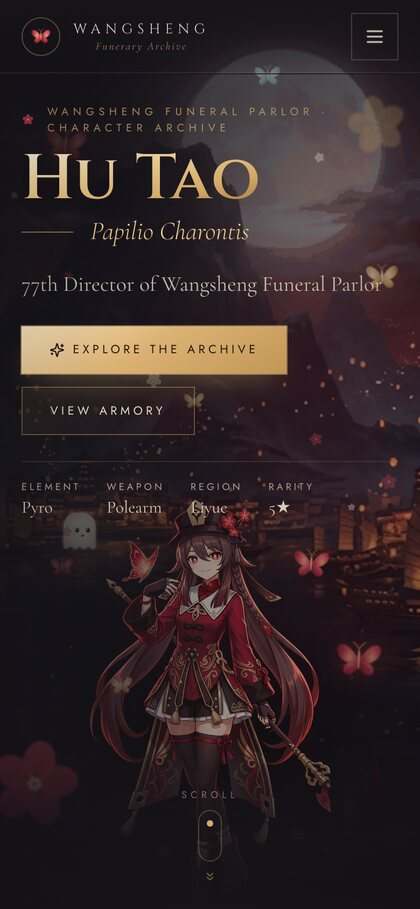

# Hu Tao — Papilio Charontis

> Every journey has its final destination.

A cinematic, fully interactive character showcase for **Hu Tao**, the 77th Director of the
Wangsheng Funeral Parlor — built as a premium, Genshin Impact–inspired archive rather than a
landing page. Seven scroll-linked chapters, a functional 3D weapon carousel, an interactive
constellation map, verified in-game data, and hand-authored decorative artwork.



---

## ✨ Features

| Chapter | What it does |
| --- | --- |
| **01 · Cinematic Hero** | Nine independently-scrubbed parallax layers (background → far scenery → environment → character → typography → floating decorations → foreground), scroll-linked character entrance, pointer-depth parallax, ambient butterflies / petals / embers, animated scroll cue. |
| **02 · Character Profile** | Portrait card with parallax drift, animated stat strip, biography, attribute grid, quote panel. |
| **03 · Combat Talents** | WAI-ARIA tab interface for the three combat talents with animated panel transitions, talent-level toggle (Lv. 1 / 6 / 10) driving the multiplier table, plus passive talents. |
| **04 · Weapon Archive** | Real CSS-3D ring carousel: 6 polearms with depth, rotation, scale, dimming and blur. Previous/next, dot selection, click-to-select, mouse drag, touch swipe, and keyboard (`←` `→` `Home` `End`). Info panel updates with rarity, Base ATK, secondary stat, passive and lore. |
| **05 · Constellations** | SVG butterfly constellation with six glowing star nodes, animated stroke drawing, active-node highlighting, description panel, and a selector list. |
| **06 · Artifacts & Builds** | Three build presets (Vaporize / Pure Pyro / General) that swap artifact sets, main stats, substat priorities, weapon picks and team compositions. |
| **07 · Gallery & Ending** | Masonry artwork grid, filmstrip carousel, accessible lightbox (Esc / arrows / thumbnail jump / focus trap), then a full-screen closing scene with slow cinematic zoom. |

Additional: sticky navigation with scroll progress and active-section tracking, full-screen mobile
menu, `prefers-reduced-motion` support, and a skip link.

### Screenshots

Captured from the running build with a real Chromium (`npm run test:visual`).

| | |
| --- | --- |
|  |  |
| **01 · Cinematic hero** | **02 · Character profile** |
|  |  |
| **03 · Combat talents** | **04 · 3D weapon archive** |
|  |  |
| **05 · Constellation map** | **06 · Artifacts & builds** |
|  |  |
| **07 · Gallery** | **Cinematic ending** |

<p align="center"></p>

---

## 🧱 Tech Stack

- **React 18 + TypeScript** (strict)
- **Vite 6**
- **Tailwind CSS 3** with a custom Genshin-inspired design system
- **GSAP 3 + ScrollTrigger** — every timeline is scoped in a `gsap.context()` and reverted on unmount
- **CSS 3D transforms** for the weapon carousel
- **Lucide React** icons
- Self-hosted fonts via Fontsource: *Cinzel* (display), *Cormorant Garamond* (serif), *Jost* (sans)

No animation libraries beyond GSAP, no UI kits, no icon sprites.

---

## 🚀 Getting Started

```bash
# 1. install
npm install

# 2. run the dev server (binds 0.0.0.0:5173)
npm run dev

# 3. production build
npm run build

# 4. preview the production build (0.0.0.0:4173)
npm run preview
```

Other scripts:

```bash
npm run typecheck   # tsc --noEmit
npm run smoke       # build + render the app in jsdom and assert it mounts
npm run test:ui     # 45 headless interaction assertions (tabs, carousel, lightbox, nav…)
```

### Verification

```bash
# render smoke test (jsdom)
npm run smoke

# 45 interaction assertions — 45/45 passing
npm run test:ui

# design-system guard: fails if any Tailwind class emits no CSS
npm run verify:classes

# real-browser checks at 4 breakpoints (needs Chromium)
npm run test:visual
```

`npm run test:visual` drives a real Chromium at 1440/1280/768/390 px and asserts
there is no horizontal overflow, the hero wordmark stays on one line, the talent
artwork fills its column, every image decodes, all eight sections have content,
and the console is clean.

`npm run test:ui` drives the real component tree in jsdom and asserts every interactive
behaviour: talent tab switching and level toggles, carousel next/prev/dots/click/swipe/keyboard,
constellation node selection, build preset switching, lightbox open/next/Escape/thumbnail nav,
navigation targets and the mobile menu.

---

## 🗂 Project Structure

```
src/
├── assets/
│   ├── characters/     # hero cutout, portrait
│   ├── weapons/        # transparent polearm renders (+ raw chroma sources)
│   ├── backgrounds/    # Liyue, parlor, celestial, weapon archive
│   ├── artifacts/      # artifact set plate
│   └── gallery/        # combat + gallery artworks
├── components/
│   ├── Navbar.tsx
│   ├── ParallaxHero.tsx
│   ├── CharacterProfile.tsx
│   ├── TalentShowcase.tsx
│   ├── WeaponCarousel3D.tsx
│   ├── ConstellationMap.tsx
│   ├── ArtifactBuilds.tsx
│   ├── Gallery.tsx
│   ├── Footer.tsx            # footer + CinematicEnding
│   └── ui/
│       ├── Section.tsx       # section shell, headings, rarity stars
│       ├── Decorations.tsx   # SVG butterflies, blossoms, ghosts, embers, petals
│       └── ArtifactIcons.tsx # artifact slot sigils
├── data/                     # verified game data (typed)
│   ├── profile.ts
│   ├── talents.ts
│   ├── weapons.ts
│   ├── constellations.ts
│   ├── artifacts.ts
│   └── gallery.ts
├── hooks/
│   ├── useScrollAnimation.ts # gsap.context scoping + cleanup
│   └── useUI.ts              # media query, scroll lock, active section, parallax…
├── lib/gsap.ts
├── styles/
│   ├── globals.css           # design system
│   └── animations.css        # ambient keyframes
├── App.tsx
└── main.tsx
```

---

## 🎨 Design System

| Token | Value | Use |
| --- | --- | --- |
| Obsidian | `#17151A` | Base surface |
| Ink | `#0E0C11` | Deepest background |
| Crimson | `#8D2636` | Primary accent / glow |
| Dark Red | `#531B29` | Panels, gradients |
| Antique Gold | `#D9AE69` | Ornaments, interactive accents |
| Ivory | `#E8DCC8` | Primary text |
| Muted Gray | `#A69A91` | Secondary text |

Recurring motifs: cut-corner **panels** with inset double borders, corner **brackets**, gold
**hairlines** and ornament dividers, plum-blossom diamonds, and a fine SVG noise **grain** overlay.
No generic SaaS cards — every surface carries a fantasy frame.

---

## 📊 Data Accuracy

All game values are the **official in-game numbers**, cross-checked against HoYoverse's published
archive via the community dataset `genshin-db` and public references:

- **Talents** — descriptions and multipliers at Lv. 1 / 6 / 10 (`Secret Spear of Wangsheng`,
  `Guide to Afterlife`, `Spirit Soother`) plus all three passives.
- **Character** — Lv. 90 base stats: **15,552 HP / 106 ATK / 876 DEF** with **38.4% CRIT DMG**
  from ascension.
- **Weapons** — Lv. 90 Base ATK and secondary stats (e.g. Staff of Homa **608 / CRIT DMG 66.2%**,
  Primordial Jade Winged-Spear **674 / CRIT Rate 22.1%**, Dragon's Bane **454 / EM 221**,
  Deathmatch **454 / CRIT Rate 36.8%**, Ballad of the Fjords **510 / CRIT Rate 27.6%**,
  Blackcliff Pole **510 / CRIT DMG 55.1%**) and R1 passive text.
- **Constellations** — C1–C6 names and descriptions.
- **Artifacts** — 2-piece / 4-piece set effect text (Crimson Witch of Flames, Shimenawa's
  Reminiscence, Gilded Dreams, Marechaussee Hunter, Wanderer's Troupe, Noblesse Oblige).

Build *recommendations* (which sets, stats and teams to favour) reflect established community
theorycrafting and are labelled as guidance, not official advice.

---

## 🖼 Asset Inventory

See **[ASSETS.md](ASSETS.md)** for the complete inventory, including which assets were generated
with an image model, which were derived, and provenance notes.

---

## ⚖️ Disclaimer

This is a **fan-made, non-commercial portfolio project**. *Genshin Impact*, *Hu Tao* and all
related names, characters and imagery are trademarks of **HoYoverse / miHoYo**. Artwork in
`src/assets` was generated specifically for this project in a Genshin-inspired style and is not
official game art. This project is not affiliated with or endorsed by HoYoverse.

---

## 📄 License

Source code: MIT. Artwork: see disclaimer above.
